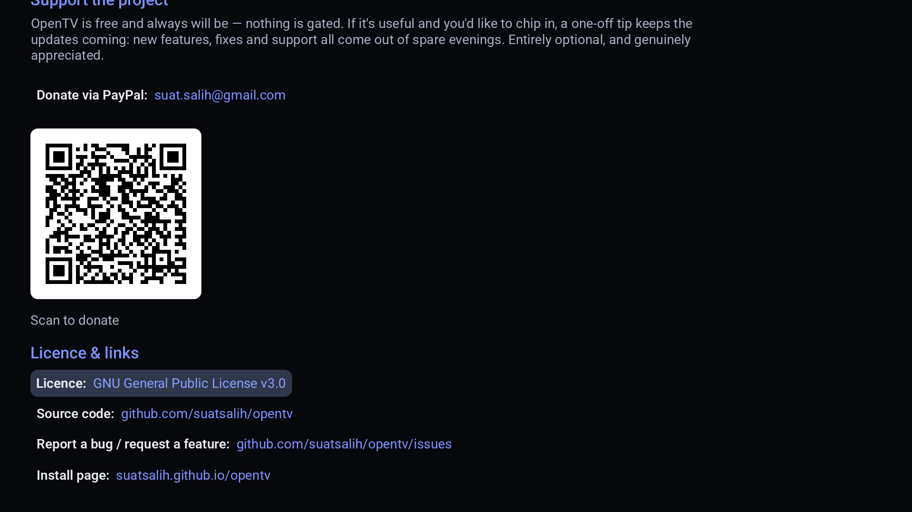

# OpenTV

**An open-source IPTV player for Android TV, Google TV, phones and tablets — [on Google Play](https://play.google.com/store/apps/details?id=io.github.suatsalih.opentv).**

No account. No subscription. No server of ours between you and your provider.

[](https://github.com/suatsalih/opentv/actions/workflows/build.yml)
[](LICENSE)

---

> **Get OpenTV on [Google Play](https://play.google.com/store/apps/details?id=io.github.suatsalih.opentv).**
> Live TV and the guide are free; OpenTV Premium is a one-off purchase, not a subscription.
> This repository is the source code — no APKs are published here.

## Why this exists

There is a recurring pattern in this corner of the app world. A promising IPTV player appears.
It looks good. It sells a "lifetime" subscription. The lifetime turns out to be shorter than
the buyer's — the developer burns out, or moves on, or simply stops replying, and everyone who
paid is left with an app that no longer works and no way to fix it.

The people affected are not helpless. They are often technical. What they lack is not skill
but *access*: the code is closed, so nobody else can pick it up.

OpenTV is the same category of app built so that cannot happen. The source is public and
GPL-licensed. If the current maintainers vanish tomorrow, anyone can fork it, build it and
keep it alive. That is the entire point.

**OpenTV is not a fork or a decompilation of any existing app.** It is written from scratch.

## What it does

- **Live TV** from Xtream Codes logins and plain M3U/M3U8 playlists
- **A guide that stays put** — XMLTV EPG that survives restarts, refreshes incrementally, and
  never wipes itself
- **Recording (DVR)** — record to the box, a USB drive or your NAS (SMB); schedule from the
  guide; series-link a whole show; play back in-app with full seeking
- **Catch-up / archive** where your provider offers it, plus **programme reminders**
- **Movies and series** with resume and per-profile watch history
- **Favourites, categories, hide channels, search**, picture-in-picture, aspect control, and
  hand-off to an external player
- **Free sync between your own devices** — favourites, watch history and NAS recordings, over
  your wifi or Tailscale, with no server of ours
- **Multiple languages** (fully translated to Spanish), a parental PIN and profiles
- **D-pad first** — designed for a remote, works with a touchscreen
- **One app** for Android TV, Google TV, phones and tablets

## Screenshots

The live TV guide — programme grid, favourites, and a live preview:


| Recordings &amp; reminders | Free cloud sync — your own NAS, no server |
| :---: | :---: |
|  |  |
| Movies &amp; series | Settings |
|  |  |

Open-source through and through — the About screen carries the licence, the links, and a donation QR:



## What it deliberately does not do

- **No servers of ours, no web dashboard, no account.** Your provider credentials never leave
  your device, and syncing happens directly between your devices — or through your own NAS —
  never through a machine we run. This is a feature, not a gap — see
  [docs/ARCHITECTURE.md](docs/ARCHITECTURE.md) for the reasoning, and note that "sync your
  channel list to *our* servers" is precisely the feature whose hosting bill makes a one-off
  payment unsustainable.
- **No content.** OpenTV is a player. You bring a service you already pay for. The project has
  no affiliation with any provider and does not help you find one.

## Install

**→ [OpenTV on Google Play](https://play.google.com/store/apps/details?id=io.github.suatsalih.opentv)** — for Android TV, Google TV, phones and tablets.

Google Play is the only place OpenTV is distributed. This repository publishes the source code,
as the GPL requires, and no ready-made APKs; if you want a build of your own, see below.

## Build it yourself

```bash
git clone https://github.com/suatsalih/opentv.git
cd opentv
./gradlew assembleDebug
```

You need JDK 17+ and the Android SDK (API 36). Android Studio will fetch it for you. The debug
builds land in `app/build/outputs/apk/<edition>/debug/` — `github` is the build with every feature
unlocked, `play` is the Google Play edition.

Run the tests:

```bash
./gradlew test
```

## How it was built

OpenTV was written with **Claude**, Anthropic's AI assistant, working from a human's
direction — the design decisions, the priorities, the "no server, ever" rule, and every
review of what shipped were the maintainer's; Claude did the bulk of the drafting, wiring and
debugging against that direction.

That is relevant here for one specific reason: **it kept the project genuinely clean-room.**
Nothing was decompiled or copied from any existing IPTV app. The code was written from public
specifications (the Xtream Codes request format, the XMLTV and M3U formats, the Kodi catch-up
tags) and from describing how other apps *behave* as a user — never from their source. That is
the legal footing that lets anyone fork this and keep it alive, which is the whole point.

## Contributing

Please do. See [CONTRIBUTING.md](CONTRIBUTING.md).

The project is explicitly looking for people who own devices the maintainers do not. Most
"works for me" bugs in this category are device-specific — an Ugoos box, a first-gen ONN, a
Fire Stick Lite — and a bug report from someone who owns one is worth more than a week of
guessing. If a channel fails on your setup, [open an issue](../../issues/new/choose).

## Supporting the project

OpenTV is distributed through [Google Play](https://play.google.com/store/apps/details?id=io.github.suatsalih.opentv). Live TV and the guide with one provider
are free; **OpenTV Premium** — one payment, no subscription — adds several providers, catch-up,
recording, movies & series and profiles. That is how the project is supported. See
[docs/PLAY_STORE.md](docs/PLAY_STORE.md).

It does not sell a "lifetime" promise — the failure mode this project was built in response to
is a promise nobody could keep, so we are not making one. And because the source is GPL, the
app can never be taken away: anyone can build it from this repository.

## Licence

[GPL-3.0-or-later](LICENSE).

Chosen deliberately. GPL means anyone can take this code, but if they ship it they must ship
their source too. Nobody gets to close it, rebrand it, and sell a lifetime subscription on top
of work the community did for free.

## Legal

OpenTV is a media player, comparable to VLC. It ships with no channels, no playlists, and no
links to any. What you point it at, and whether you are entitled to, is between you and your
provider.
